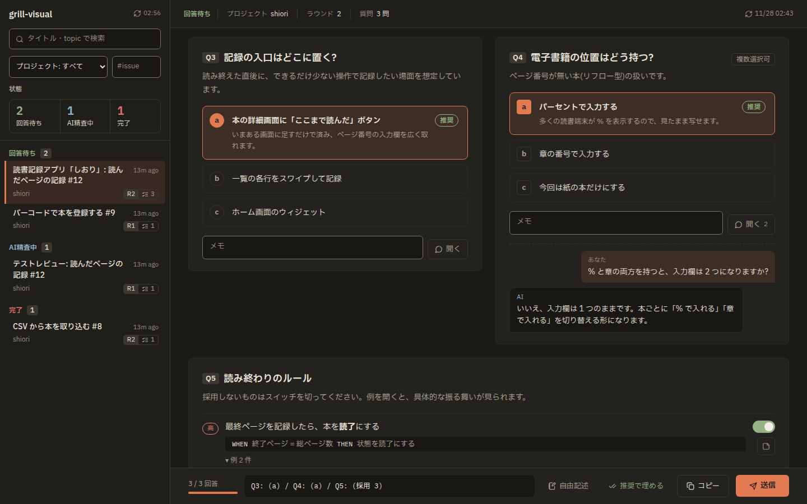

# grill-visual

計画や設計を実装の前に問い詰める「grill」を、ブラウザの質問票で行う [Claude Code](https://claude.com/claude-code) 用のスキルです。

AI が質問を JSON に書き、タブ式の HTML 質問票として配信します。あなたは選択肢を選び、必要ならメモを書いて送信します。AI は回答ファイルが現れるのを待っていて、届くと次のラウンドに進みます。



## できること

- **ラウンド制**: 前提が決まった質問だけをまとめて聞く。各質問に推奨案と理由が付き、「推奨で埋める」で一括して選べる
- **設計ツリー**: 決まった項目と未決の項目をツリーで見せる
- **ルール一覧型の問い**(`"type": "rules"`): 1 問の中にルールが並び、行ごとにスイッチで採用・不採用を決める。行を開くと具体例(振る舞い → 期待する結果)が読め、行ごとに 1 行コメントを書ける。テストケースの承認などに使う
- **各問のチャット**: メモ欄に書いて「聞く」を押すと、その問いについて AI に質問できる。返事は同じカードの中に出る
- **統合ページ**: 複数のセッションが出した質問票を 1 つの URL で一覧し、切り替える。回答待ち・AI 精査中・完了に分かれ、プロジェクトや issue 番号で絞り込める。終わったものはアーカイブして隠せる
- **下書き保存**: 送信前の選択やメモは、ページを開き直しても残る
- **画面の幅に合わせた表示**: 広い画面では問いを 2〜3 列に並べ、スマホでは 1 列にして一覧をドロワーにする
- **アイコン**: 操作と状態の目印に [Lucide](https://lucide.dev) の線画を使う(ISC ライセンス。[docs/LUCIDE-LICENSE](docs/LUCIDE-LICENSE))

UI は日本語だけです。

## 必要なもの

- Claude Code
- Python 3.10 以上(標準ライブラリだけで動く)
- `curl`・`setsid`・`ss`(配信サーバーの起動と再起動に使う。Linux / WSL を想定)
- テストを動かすなら [uv](https://docs.astral.sh/uv/)

## 導入

```bash
git clone https://github.com/Luka-Magic/grill-visual.git ~/.claude/skills/grill-visual
```

Claude Code で「grill して」「質問票で聞いて」と頼むと使われます。

AI は最初に `serve.sh` で配信サーバーを起動し、質問票の URL(`http://localhost:8787/#<題材>`)をチャットに出します。その URL を開いて答えてください。

## 置き場所と設定

質問データ・質問票・回答・チャット・画像は `~/.agent/diagrams/` に置かれます。

| パス | 中身 |
|---|---|
| `grill-data/<題材>.json` | AI が書く質問データ |
| `grill-<題材>.html` | `render.py` が作る質問票 |
| `answers/<題材>-round-<N>.json` | 送信された回答 |
| `chat/<題材>.jsonl` | 各問のチャット |
| `assets/<題材>/` | 質問に添える画像やモック |

どれも未設定で動きます。必要なときだけ環境変数で変えてください。

| 変数 | 既定 | 用途 |
|---|---|---|
| `GRILL_PORT` | `8787` | 配信サーバーのポート |
| `PARALLEL_GRILL_URL` | `http://localhost:8787/` | AI がチャットに出す URL の根 |
| `GRILL_ROOT` | `~/.agent/diagrams` | `render.py`・`server.py`・`chat.py` が読み書きする場所。テストとお試し用サーバーが使う(`serve.sh` は既定の場所で起動する) |

### 別の端末(スマホなど)から答える

サーバーは `127.0.0.1` でだけ待ち受けます。別の端末から開くには、VPN のリバースプロキシなどで `127.0.0.1:8787` を中継し、その URL を `PARALLEL_GRILL_URL` に設定してください。AI がチャットに出す URL がその URL になります。

回答の送信(`POST /submit`)やチャット(`POST /api/chat`)には認証がありません。中継する先は、自分だけが入れる閉じたネットワークに限ってください。

## セキュリティ

質問データの文字列は HTML として表示しますが、`sanitize.py` が許可したタグと属性だけを通します。

- `<code>`・`<strong>`・表・画像・リンクなどは使える
- `<script>` などの許可していないタグは、動かさずに文字として見せる
- `onclick` などのイベント属性と、`javascript:`・`data:` の URL は取り除く
- ユーザーが入力した文字列(メモ・自由記述・行のコメント)は HTML として扱わず、打ったとおりに見せる
- 質問データの描画は問いカードなどの枠の中に閉じ込め、送信バーや他の問いに重ならないようにする

issue の本文など外部の文章が質問に混ざっても、スクリプトは動きません。文中に `<` を書くときは `&lt;` と書いてください(`<名前>` のような書き方は、文字として表示されます)。

## お試し用のサーバー(見た目を直すとき)

質問票や統合ページの見た目を直すあいだは、普段使いとは別の場所・別のポートでサーバーを動かせます。

```bash
./trial.sh            # 起動(127.0.0.1:8791、配信ルートは ~/.agent/diagrams-trial)
./trial.sh --restart  # 起動し直す
./trial.sh --stop     # 止める
```

お試し用の質問票は `GRILL_ROOT=~/.agent/diagrams-trial` を付けて `render.py` を動かして作ります。ui-comments スキル(画面の要素を指してコメントする道具)が入っていれば、お試し用のサーバーにだけ読み込みます。

## 構成

| ファイル | 役割 |
|---|---|
| `SKILL.md` | AI 向けの手順(インタビューの進め方・データの書き方) |
| `render.py` | 質問データ JSON から質問票 HTML を作る |
| `sanitize.py` | 質問データの HTML を許可リスト方式でサニタイズする |
| `icons.py` | 質問票で使うアイコン(Lucide) |
| `server.py` | 配信・回答の受信・統合ページとチャットの API |
| `state.py` | 題材ごとの状態(待ち / 回答済み / 完了 / エラー)をファイルから導く |
| `chat.py` | 各問のチャットの保存と、AI 側の CLI(`watch` / `reply`) |
| `dashboard.html` | 統合ページ |
| `serve.sh` | 配信サーバーの冪等な起動(`--restart` で起動し直す) |
| `trial.sh` | お試し用のサーバー |

## テスト

```bash
uvx pytest -q tests
```

## 謝辞

インタビューの進め方は、Matt Pocock の [grilling](https://github.com/mattpocock/skills/tree/main/skills/productivity/grilling) スキルをもとにしています。

## ライセンス

[MIT](LICENSE)
