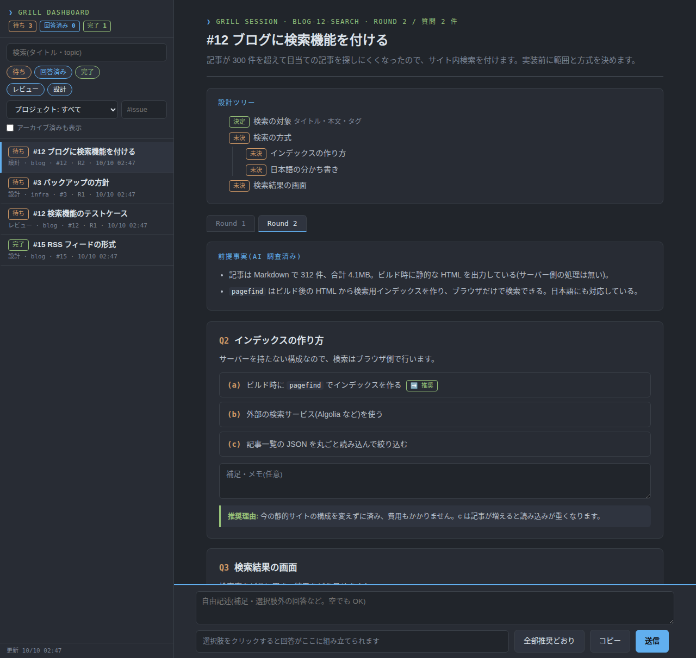

# grill-visual

計画や設計を実装前に問い詰める「grill」を、ブラウザの質問票で行う [Claude Code](https://claude.com/claude-code) 用のスキルです。

AI が質問を JSON に書き、タブ式の HTML 質問票として配信します。あなたは選択肢を選び、メモを書いて送信するだけです。AI は回答ファイルの出現を待っていて、届くと次のラウンドに進みます。



- **ラウンド制**: 前提が決まった質問だけをまとめて聞き、各質問に推奨案と理由を付ける
- **設計ツリー**: 決定済み・未決の項目をツリーで表示する
- **統合ページ**: 複数のセッションが出した質問票を 1 つの URL で一覧・切り替えできる
- **下書き保存**: 送信前の選択やメモは、ページを開き直しても残る
- **スマホ対応**: 統合ページはモバイルではドロワー表示になる

UI は日本語のみです。

## 必要なもの

- Claude Code
- Python 3.10 以上(標準ライブラリのみで動く)
- `curl`・`setsid`(配信サーバーの起動に使う。Linux / WSL を想定)
- テストを動かす場合は [uv](https://docs.astral.sh/uv/)

## 導入

```bash
git clone https://github.com/Luka-Magic/grill-visual.git ~/.claude/skills/grill-visual
```

Claude Code で「grill して」「質問票で聞いて」と頼むと使われます。プロジェクトの `.claude/skills/` に置いても動きます。

## 設定

どれも未設定で動きます。必要なときだけ環境変数で変えてください(Claude Code なら `settings.json` の `env` に書けます)。

| 変数 | 既定 | 用途 |
|---|---|---|
| `GRILL_ROOT` | `~/.claude/grill-visual` | 質問データ・質問票・回答・画像の置き場所 |
| `GRILL_PORT` | `8787` | 配信サーバーのポート |
| `GRILL_URL` | `http://localhost:8787/` | AI がチャットに出す URL の根 |

### 別の端末(スマホなど)から回答する

サーバーは `127.0.0.1` でだけ待ち受けます。別の端末から開くには、VPN のリバースプロキシなどで `127.0.0.1:8787` を中継し、その URL を `GRILL_URL` に設定してください。AI がチャットに出す URL がその URL になります。

回答の送信(`POST /submit`)には認証がありません。中継する先は、自分だけが入れる閉じたネットワークに限ってください。

## セキュリティ

質問票の文字列は HTML として表示されますが、`sanitize.py` が許可したタグ・属性だけを通します。`<script>`、`onclick` などのイベント属性、`javascript:` の URL は取り除かれるので、issue の本文など外部の文章を質問に含めてもスクリプトは動きません。

## 構成

| ファイル | 役割 |
|---|---|
| `SKILL.md` | AI 向けの手順(インタビューの進め方・データの書き方) |
| `render.py` | 質問データ JSON から質問票 HTML を作る |
| `sanitize.py` | 質問データの HTML を許可リスト方式でサニタイズする |
| `server.py` | 配信・回答の受信・統合ページの API |
| `state.py` | 題材ごとの状態(待ち / 回答済み / 完了)をファイルから導く |
| `dashboard.html` | 統合ページ |
| `serve.sh` | 配信サーバーの冪等起動 |

## テスト

```bash
uvx pytest -q tests
```

## 謝辞

インタビューの進め方は、Matt Pocock の [grilling](https://github.com/mattpocock/skills/tree/main/skills/productivity/grilling) スキルをもとにしています。

## ライセンス

[MIT](LICENSE)
